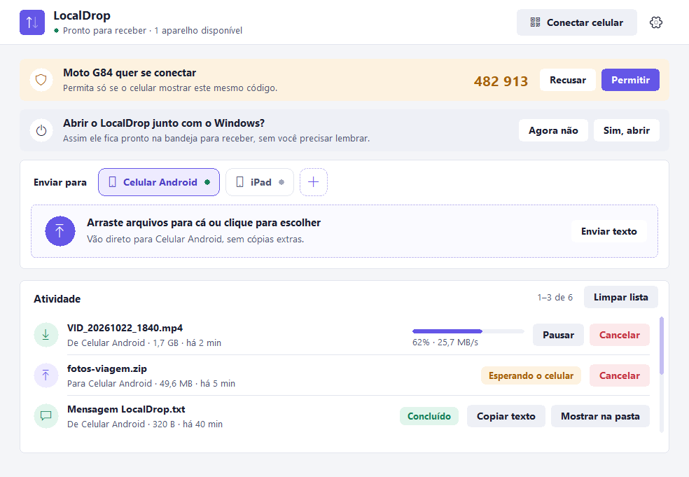
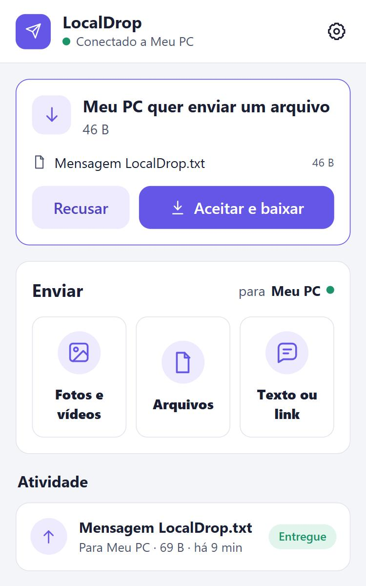
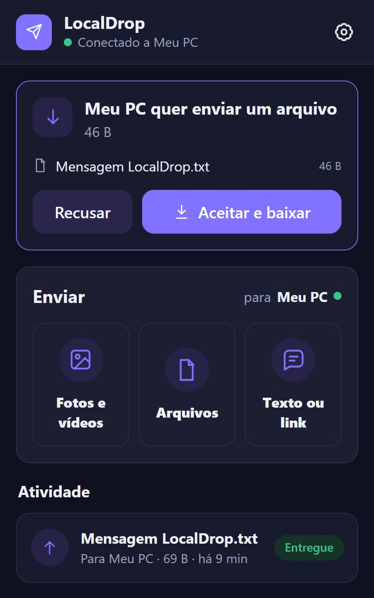
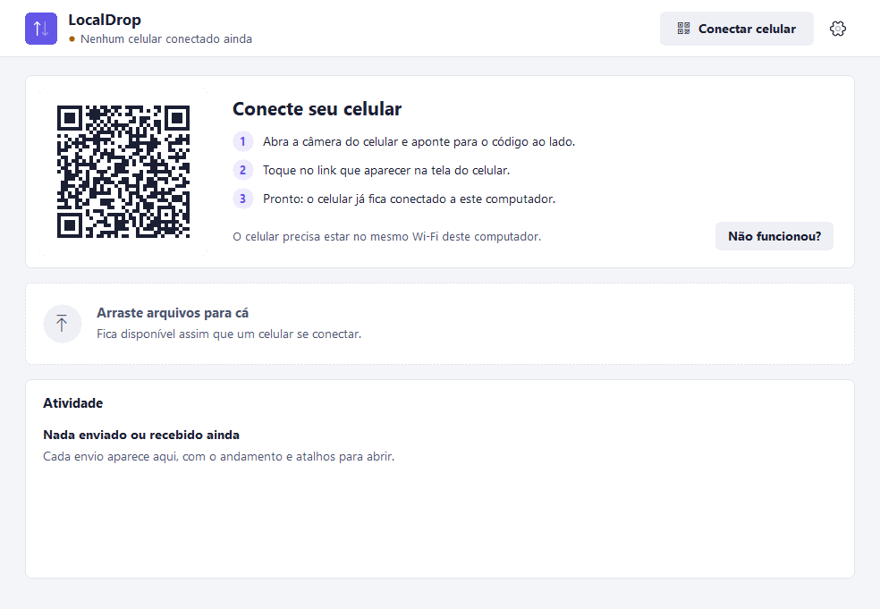
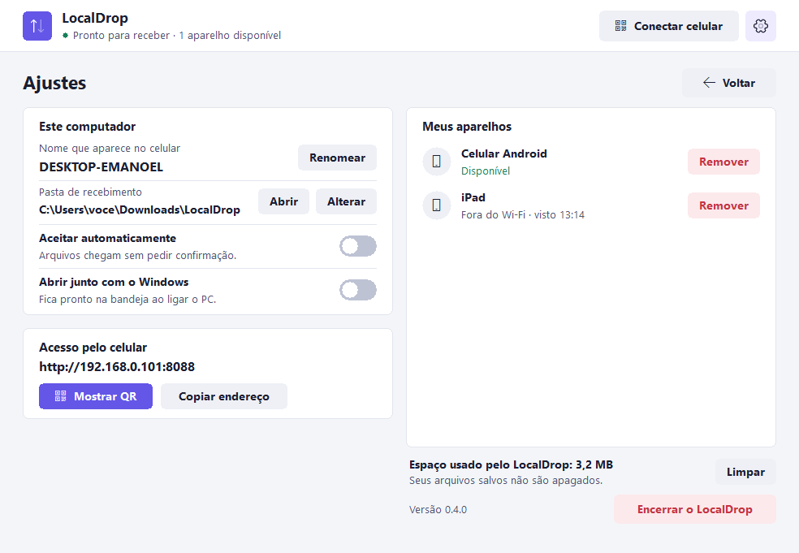

# LocalDrop

Passe arquivos e textos entre o PC e o celular pela sua própria rede Wi-Fi. Sem cabo, sem conta, sem nuvem e sem instalar nada no celular.

No Windows, o LocalDrop é um único `.exe` de cerca de 8 MB com janela nativa (sem navegador embutido). No celular, basta apontar a câmera para o QR Code: a interface abre no navegador.

> O transporte é HTTP dentro da rede local. O pareamento e os tokens controlam quem acessa, mas não cifram o tráfego. Use em uma rede privada e confiável. Veja [Segurança](docs/SECURITY.md).



<p>
  
  
</p>

## O que ele resolve

Mandar um vídeo do celular para o PC costuma virar uma volta: enviar para si mesmo no WhatsApp (que comprime), subir para a nuvem e baixar de novo, ou procurar um cabo. O LocalDrop faz a transferência direta, dentro da casa ou do escritório:

- **sem perda de qualidade:** o arquivo chega idêntico, conferido por SHA-256;
- **sem limite de tamanho da nuvem:** arquivos de vários GB, com retomada se a conexão cair;
- **sem cadastro e sem internet:** nada sai da rede local, não há telemetria nem serviço externo;
- **sem app no celular:** funciona no navegador do Android e do iPhone.

## Começar a usar

1. Baixe o `LocalDrop.exe` na [página de versões](https://github.com/EmanuelCandido/Local-Drop/releases/latest) e abra.
2. Aponte a câmera do celular para o QR Code que aparece na janela e toque no link.
3. Confira se o código de 6 dígitos é o mesmo nas duas telas e clique em **Permitir** no PC.
4. Pronto: arraste arquivos para a janela do PC ou toque em **Fotos e vídeos**, **Arquivos** ou **Texto ou link** no celular.

O celular e o computador precisam estar na mesma rede Wi-Fi. Se o Windows estiver bloqueando a conexão (rede marcada como pública ou firewall), a própria janela mostra um aviso com o botão **Corrigir**.

Arquivos recebidos no PC vão para `%USERPROFILE%\Downloads\LocalDrop` (dá para trocar nos Ajustes).

> O executável ainda não tem assinatura digital, então o Windows SmartScreen pode avisar na primeira abertura. Clique em **Mais informações** e depois em **Executar assim mesmo**.

<p>
  
  
</p>

## Como é usar

**No computador**

- uma tela só: escolha o aparelho, arraste arquivos ou pastas para a janela e eles já ficam disponíveis no celular;
- `Ctrl+V` envia o texto copiado e `Ctrl+O` abre o seletor de arquivos;
- pedidos de pareamento e arquivos chegando aparecem no topo, com **Permitir** e **Aceitar** ali mesmo;
- cada transferência tem atalhos: **Abrir**, **Mostrar na pasta**, **Copiar texto**, **Pausar** e **Cancelar**;
- fechar a janela deixa o LocalDrop na bandeja, pronto para receber; avisos do Windows informam o que chegou;
- arquivos enviados ao celular não são copiados: o celular baixa direto do original.

**No celular**

- três botões de envio: **Fotos e vídeos**, **Arquivos** e **Texto ou link**;
- ofertas do PC aparecem no topo com **Aceitar e baixar**, e o download vai para o gerenciador do próprio navegador;
- textos recebidos abrem com **Ver texto** e **Copiar**;
- tema claro, escuro ou automático;
- o navegador pode oferecer **Adicionar à tela inicial** para virar um atalho.

## Como funciona

```text
┌────────────────────────────┐      memória do processo   ┌────────────────────────────┐
│ Janela nativa do Windows   │ ◄────────────────────────► │ Núcleo em Go               │
│ Win32 + GDI, sem WebView   │                            │ API, transferência, estado │
└────────────────────────────┘                            └──────────────┬─────────────┘
                                                                         │ HTTP + WebSocket na LAN
                                                                         ▼
                                                          ┌────────────────────────────┐
                                                          │ Celular                    │
                                                          │ React no navegador         │
                                                          └────────────────────────────┘
```

- **Um executável só.** O servidor HTTP, a janela nativa e o bundle web do celular ficam no mesmo binário Go. Go e Node.js não são necessários para rodar.
- **Pareamento por código.** O QR Code leva um convite de uso único válido por 5 minutos. O celular pede acesso, as duas telas mostram o mesmo código e o PC aprova. Cada aparelho recebe um token próprio, que pode ser revogado nos Ajustes.
- **Transferência em blocos.** Blocos de 4 MiB com SHA-256 por bloco, gravados direto na posição final, quatro em paralelo. O arquivo é lido uma única vez no envio, e blocos já confirmados não são reenviados ao retomar.
- **Rede.** O IP é escolhido pela rota padrão e pelo tipo real da placa. A porta fica entre 8088 e 8098, escolhida automaticamente e guardada. Uma segunda abertura do programa só traz a janela de volta.
- **Leve em segundo plano.** Na bandeja, a janela não consulta nem redesenha nada; o estado chega por eventos internos, sem polling.

Detalhes em [Arquitetura](docs/ARCHITECTURE.md) e [API HTTP e WebSocket](docs/API.md).

## Construir a partir do código

Requisitos de desenvolvimento:

- Go 1.27+ no `PATH`, ou a toolchain portátil em `.tools\go`;
- Node.js `^20.19.0` ou `>=22.12.0` e npm.

Windows:

```powershell
.\scripts\build.ps1
```

Linux/macOS:

```bash
./scripts/build.sh
```

O build compila o React, copia o bundle para `go-backend/web`, roda os testes e a análise estática do Go e gera um único executável em `dist`.

Para reaproveitar um `frontend/dist` já criado:

```powershell
.\scripts\build-go.ps1 -SkipFrontend
```

## Desenvolvimento

Windows:

```powershell
.\scripts\dev.ps1
```

Linux/macOS:

```bash
./scripts/dev.sh
```

O Vite fica em `http://localhost:5173` e encaminha a API para o Go em `http://localhost:8088`.

Comandos isolados:

```powershell
Set-Location frontend
npm run lint
npm run test
npm run build

Set-Location ..\go-backend
go test ./...
go vet ./...
```

Para revisar a janela nativa sem abrir o programa, o teste `TestRenderDesktopPreview` desenha as telas fora da tela e salva PNGs na pasta indicada em `LOCALDROP_PREVIEW_DIR`.

O guia visual dos dois apps (cores, decisões e perguntas em aberto) está em [DESIGN.md](DESIGN.md).

## Configuração

Nome, pasta de recebimento, aceite automático, abrir com o Windows e tema são editáveis na interface.

| Variável | Padrão | Finalidade |
|---|---:|---|
| `LOCALDROP_PORT` | automática (8088 a 8098) | Fixar a porta HTTP da rede |
| `LOCALDROP_AUTO_OPEN` | `true` | Abrir a janela nativa do desktop |
| `LOCALDROP_STORAGE_ROOT` | `~/.localdrop` | Estado e arquivos temporários |
| `LOCALDROP_DOWNLOADS` | `~/Downloads/LocalDrop` | Pasta inicial de recebimento do host |
| `LOCALDROP_TRANSFER_CHUNK_SIZE` | `4194304` | Tamanho de cada bloco em bytes |
| `LOCALDROP_TRANSFER_MINIMUM_FREE_SPACE` | `104857600` | Reserva mínima de disco após a transferência |
| `LOCALDROP_TRANSFER_INACTIVITY_TIMEOUT` | `10m` | Tempo até pausar uma transferência parada |
| `LOCALDROP_TRANSFER_TEMPORARY_LIFETIME` | `24h` | Retenção de temporários |
| `LOCALDROP_TRANSFER_CREATE_RATE_LIMIT` | `20` | Ofertas por janela de tempo e dispositivo |

Opções de linha de comando:

```powershell
.\dist\LocalDrop.exe --port 8089 --headless   # só o servidor, sem janela nem bandeja
.\dist\LocalDrop.exe --tray                    # abre direto na bandeja (usado ao iniciar com o Windows)
```

## Dados locais

```text
~/.localdrop/
├── localdrop-go.json   # metadados e hashes de autenticação
├── localdrop-go.log    # diagnóstico local, sem tokens
├── go-completed/       # recebimentos do celular, até o download
└── outbox/             # textos enviados pelo PC com Ctrl+V
```

O conteúdo dos arquivos nunca entra no JSON. Enquanto chega, um arquivo fica como `nome.xxxxxxxx.localdrop` na pasta de recebimento e é renomeado ao terminar. Arquivos entregues na pasta do host não são apagados pela limpeza de temporários.

## Limites atuais

- HTTP local não protege contra quem consegue interceptar o tráfego da LAN.
- A janela nativa existe só no Windows; em outros sistemas o serviço roda em modo `--headless`.
- Não há descoberta automática (mDNS) nesta versão: o QR Code e o endereço IP são o caminho.
- O executável não tem assinatura digital.

## Documentação

- [Arquitetura](docs/ARCHITECTURE.md)
- [API HTTP e WebSocket](docs/API.md)
- [Segurança](docs/SECURITY.md)
- [Solução de problemas](docs/TROUBLESHOOTING.md)
- [Guia visual](DESIGN.md)

## Licença

[MIT](LICENSE)
